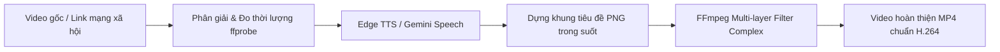

# 🎬 BÁO CÁO NÂNG CẤP MEDIA ENGINE (MEDIA ENGINE REPORT)

**Dự án:** TOOLZUTTER 3.0 Media Engine  
**Hệ thống xử lý:** News Card Studio & Video News Studio

---

## 1. NEWS CARD STUDIO (TRÌNH DỰNG ẢNH THẺ TIN TỨC)

### Hiện trạng & Cơ chế hoạt động:
- Hỗ trợ kết xuất đồ họa HTML5 Canvas & Puppeteer Headless.
- Tự động co giãn cỡ chữ tiêu đề thông minh (`fitHeadline`) đảm bảo dải chữ không vượt quá 32% chiều cao ảnh và tối đa 4 dòng.
- Tạo vùng ảnh trong suốt (`omitBackground: true`) phục vụ lớp phủ trên Video Reels.

### Các cải tiến đã hoàn thiện:
1. **Font Tiếng Việt chuẩn hóa**:
   - Sử dụng Google Fonts `Montserrat` (weights 800, 900) với `subset=vietnamese`.
   - Cơ chế dự phòng font mượt mà: Đợi font tối đa 5s (`document.fonts.ready`), nếu mất mạng tự động chuyển sang `'Arial Black', 'Helvetica Neue', Arial, sans-serif` mà không bị vỡ bố cục hoặc lỗi ký tự (tofu).
2. **Tái sử dụng Page Instance**:
   - Worker sử dụng `browserPool.acquireContext()` thay vì khởi động lại trình duyệt Chromium mới mỗi lần render thẻ tin.
   - Chặn toàn bộ các request không liên quan (tracking, ads, external scripts) qua `page.route()`, chỉ cho phép nạp font Google và ảnh bài viết.

---

## 2. VIDEO NEWS STUDIO (BIÊN TẬP VIDEO ĐA TẦNG)

### Kiến trúc Pipeline Xử lý:

### Các tính năng cốt lõi:
1. **Hook 5s Auto Reveal (Giữ chân người xem)**:
   - Trong 5 giây đầu: Khung thẻ tin xuất hiện nổi bật cùng giọng đọc AI.
   - Sau thời gian đọc: Khung áp dụng hiệu ứng chuyển cảnh mượt mà (`fade out`, `slidedown`, `wipeleft`) và video phóng to toàn màn hình.
2. **Audio Ducking thời gian thực**:
   - Tiếng gốc tự động hạ âm lượng (`duckVolume: 0.2`) trong đúng khoảng thời gian giọng đọc AI phát (`voiceSpans`).
   - Kết thúc câu đọc, tiếng gốc tự động hồi phục về mức ban đầu mà không bị giật âm.
3. **Tối ưu hóa phần cứng & Luồng xử lý FFmpeg**:
   - Bổ sung tham số `-threads 0` trên toàn bộ lệnh render.
   - Sử dụng `-movflags +faststart` giúp video xem được ngay lập tức trên web/mobile khi đang tải (progressive streaming).
   - Dọn dẹp tức thì toàn bộ file tạm (`overlayPng`, `brandPng`, `vs_fc_*.txt`) ngay trong khối `finally`.
   - Bổ sung cơ chế quét dọn tự động thư mục `worker/debug_output` và `uploads/` định kỳ qua `StorageCleanupService`.

