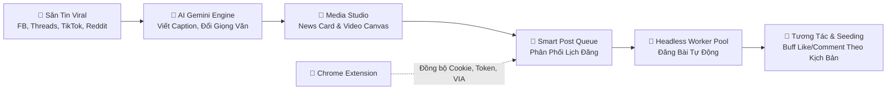

<div align="center">

# 🚀 SOCIAL MEDIA AUTOMATION SAAS PLATFORM
### Nền Tảng Tự Động Hóa Đăng Bài, Sáng Tạo Nội Dung & Quản Lý Đa Kênh Mạng Xã Hội

[](https://reactjs.org/)
[](https://www.typescriptlang.org/)
[](https://spring.io/projects/spring-boot)
[](https://www.oracle.com/java/)
[](https://pptr.dev/)
[](https://www.docker.com/)
[](https://ai.google.dev/)
[](https://tailwindcss.com/)

<p align="center">
  <b>Hệ sinh thái tự động hóa toàn diện:</b> Săn tin viral (Facebook/Threads/TikTok/Reddit) → Biên tập đồ họa & video tin tức tự động → Phân tích AI Gemini → Lập lịch & Điều phối đăng bài đa kênh không cần can thiệp thủ công.
</p>

</div>

---

## 📑 Mục Lục
- [Tổng Quan Hệ Thống](#-tổng-quan-hệ-thống)
- [Tính Năng Nổi Bật](#-tính-năng-nổi-bật)
- [Kiến Trúc & Công Nghệ](#-kiến-trúc--công-nghệ)
- [Cấu Trúc Thư Mục Dự Án](#-cấu-trúc-thư-mục-dự-án)
- [Khởi Chạy Nhanh Bằng Docker](#-khởi-chạy-nhanh-bằng-docker)
- [Hướng Dẫn Chạy Môi Trường Phát Triển (Local Dev)](#-hướng-dẫn-chạy-môi-trường-phát-triển-local-dev)
- [Cài Đặt Chrome Extension (Manifest V3)](#-cài-đặt-chrome-extension-manifest-v3)
- [Biến Môi Trường (Environment Variables)](#-biến-môi-trường-environment-variables)
- [Cơ Chế Bảo Mật & Chống Checkpoint](#-cơ-chế-bảo-mật--chống-checkpoint)
- [Tác Giả & Bản Quyền](#-tác-giả--bản-quyền)

---

## 🌟 Tổng Quan Hệ Thống

**Social Media Automation SaaS** là giải pháp doanh nghiệp được thiết kế cho các nhà sáng tạo nội dung, Agency truyền thông và đội ngũ Digital Marketing nhằm tối ưu hóa 90% thời gian vận hành mạng xã hội.

Hệ thống kết hợp sức mạnh của **Spring Boot 3 (High-throughput Backend)**, **React 18 + Vite (Modern Dashboard)**, **Headless Browser Pool (Node.js Puppeteer/Playwright Worker)** và **Google Gemini AI** để tạo thành một chuỗi cung ứng nội dung khép kín từ khâu thu thập thông tin đến xuất bản và nuôi tương tác.



---

## 🚀 Tính Năng Nổi Bật

### 1. 🎨 News Card Studio (Tạo Thẻ Tin Tức Chuyên Nghiệp)
- Tự động tạo ảnh tin tức chuẩn báo chí, typography hiện đại với tỷ lệ đa dạng: `1:1 (Square)`, `4:5 (Portrait)`, `16:9 (Landscape)`, `9:16 (Story/Reel)`.
- Tùy biến linh hoạt: Category Badge, Header Tagline, Watermark chống trộm bản quyền, Custom Logo thương hiệu.
- Hỗ trợ chế độ ảnh đơn, ảnh đôi, ảnh trích dẫn (Quote Card) và Confession không viền hiện đại.
- Tự động tối ưu độ tương phản, video blur mask nền và xuất ảnh chất lượng cao tức thì thông qua render canvas / puppeteer.

### 2. 🎬 Video News Studio & Video Editor Đa Tầng
- Dựng video tin tức ngắn (Reels, TikTok, Shorts) tự động từ bài viết.
- **Timeline Đa Layer**: Ghép nhiều phân đoạn video, ảnh nền, hiệu ứng chữ chạy và Audio Waveform sinh động.
- **Dynamic Text-to-Speech (TTS)**: Tích hợp đọc giọng AI tự nhiên, tự động canh khớp phụ đề.
- **Hook Video 5s**: Tự động chuyển cảnh và fade-out khung tin tức để lộ toàn màn hình video gốc cuốn hút người xem.
- Quản lý watermark chuyển động với tùy chọn vị trí kéo thả, làm mờ nguồn video tùy chỉnh.

### 3. 🤖 Playwright Poster & Bộ Điều Phối Đăng Thông Minh
- Tự động đăng tải bài viết, hình ảnh, video lên hàng loạt **Facebook Pages, Groups và Profile**.
- **Chế độ Co-Admin Target**: Tự động luân phiên tài khoản VIA / Co-Admin để đăng bài vào nhóm nhằm giảm tải rủi ro checkpoint.
- **Human Delay Simulation**: Giả lập hành vi người dùng, ngẫu nhiên hóa thời gian chờ giữa các bài đăng, đổi User-Agent và Fingerprint thiết bị.
- Hàng đợi đăng bài thông minh (**Smart Post Queue**) hỗ trợ Retry tự động khi gặp sự cố kết nối.

### 4. 📡 Viral Hunter & News Radar (Săn Tin Xu Hướng)
- Quét liên tục các bài viết thịnh hành nhất từ Fanpage đối thủ, Group Facebook, Threads, TikTok và các subreddit nổi tiếng.
- Lọc theo tỷ lệ tương tác (Reactions, Comments, Shares) để phát hiện bài viết có tiềm năng viral cao nhất trong 24 giờ.
- Xem trước nội dung, tải trực tiếp video/ảnh gốc về thư viện nội bộ chỉ với 1 cú click.

### 5. 🧠 Trí Tuệ Nhân Tạo Google Gemini Tích Hợp
- Tự động tóm tắt bài viết dài thành điểm tin ngắn gọn, xúc tích.
- Biến tấu tiêu đề dạng "Clickbait văn minh", tạo cảm giác tò mò mà không phản cảm.
- Sinh Caption tự động theo nhiều phong cách: *Báo chí nghiêm túc, Hài hước GenZ, Kể chuyện Storytelling, Tranh luận thảo luận*.
- Đề xuất bộ Hashtag chuẩn SEO theo từng chủ đề nội dung.

### 6. 💬 Buff Engagement & Tự Động Hóa Seeding
- Hỗ trợ thiết lập kịch bản tương tác: Buff cảm xúc (Like, Love, Haha, Wow), Comment mồi, phản hồi comment.
- Hẹn giờ seeding sau khi bài viết vừa xuất bản nhằm kích hoạt thuật toán phân phối nội dung của nền tảng.

### 7. 🔑 Quản Lý Tài Khoản VIA & Cookie Health-Check
- Theo dõi trạng thái hoạt động của hàng trăm tài khoản VIA, Page Token và Cookie.
- Cơ chế kiểm tra tình trạng kết nối thời gian thực (Live/Die/Checkpoint).
- Modal cập nhật nhanh Cookie & Token không làm gián đoạn lịch đăng đang chạy.

### 8. 🧩 Chrome Extension Manifest V3 Đồng Bộ 1-Click
- Trích xuất tự động `c_user`, `xs`, `fb_dtsg`, Access Token `EAAB...` từ phiên đăng nhập Facebook hợp lệ.
- Đồng bộ trực tiếp về máy chủ qua API mã hóa an toàn mà không cần nhập mật khẩu tài khoản.

---

## 🛠️ Kiến Trúc & Công Nghệ

| Thành Phần | Công Nghệ Sử Dụng | Vai Trò & Chức Năng |
| :--- | :--- | :--- |
| **Frontend Web** | React 18, TypeScript, Vite, Tailwind CSS, Lucide Icons, Canvas API | Giao diện điều khiển SPA, Studio đồ họa & biên tập video, lịch biểu xuất bản |
| **Backend API** | Java 17, Spring Boot 3, Spring Data JPA, Spring Security, JWT | Xử lý nghiệp vụ chính, bảo mật, điều phối lịch đăng, xác thực người dùng, tích hợp Gemini AI |
| **Automation Worker** | Node.js, Express, Puppeteer, Playwright, Chromium Headless | Cào dữ liệu mạng xã hội, render ảnh tin tức độ phân giải cao, tự động hóa tương tác |
| **Chrome Extension** | JavaScript (ES6+), Chrome Extension Manifest V3 | Hỗ trợ quản trị viên bắt Cookie/Token Facebook an toàn chỉ với 1 thao tác |
| **Cơ Sở Dữ Liệu** | MySQL 8.0 (InnoDB, UTF8mb4) | Lưu trữ thông tin tài khoản, chiến dịch, hàng đợi xuất bản, lịch sử tương tác |
| **Hạ Tầng / DevOps** | Docker, Docker Compose, Nginx Reverse Proxy | Đóng gói môi trường đồng nhất, mở rộng quy mô linh hoạt |

---

## 📂 Cấu Trúc Thư Mục Dự Án

```plaintext
TOOLZUTTER/auto-post-saas/
├── backend/                             # ☕ Spring Boot 3 Backend
│   ├── src/main/java/com/autopost/saas/
│   │   ├── config/                      # SecurityConfig, CorsConfig, AppConfig
│   │   ├── controller/                  # REST Controllers (Auth, Campaign, PostQueue, Video,...)
│   │   ├── entity/                      # JPA Entities (User, SocialAccount, Campaign, Post,...)
│   │   ├── repository/                  # Spring Data JPA Repositories
│   │   ├── scheduler/                   # CampaignScheduler, PostQueueScheduler
│   │   ├── security/                    # JWT Token Provider, CustomUserDetailsService
│   │   └── service/                     # Business Logic, GeminiService, ScraperService,...
│   ├── src/main/resources/
│   │   ├── application.yml              # Cấu hình chính của hệ thống
│   │   └── application-dev.yml          # Cấu hình môi trường dev
│   ├── pom.xml                          # Maven dependencies
│   └── Dockerfile                       # Docker build cho backend
│
├── frontend/                            # ⚡ React 18 + Vite SPA Frontend
│   ├── src/
│   │   ├── components/
│   │   │   ├── layout/                  # DashboardLayout, Sidebar, Navbar
│   │   │   ├── modals/                  # QuickUpdateCookieModal, AiSettingsModal,...
│   │   │   ├── VideoEditor/             # Trình biên tập video đa tầng, timeline, preview
│   │   │   └── VideoStudio/             # Khung overlay thẻ tin, sóng âm waveform
│   │   ├── pages/
│   │   │   ├── Dashboard.tsx            # Thống kê tổng quan hoạt động
│   │   │   ├── NewsCardStudio.tsx       # Studio thiết kế thẻ ảnh tin tức
│   │   │   ├── VideoNewsStudio.tsx      # Studio tạo video tin tức tự động
│   │   │   ├── PlaywrightPoster.tsx     # Quản lý đăng bài & hàng đợi tự động
│   │   │   ├── ViralHunter.tsx          # Radar quét tin tức thịnh hành
│   │   │   ├── Connections.tsx          # Quản lý tài khoản VIA, Fanpage, Groups
│   │   │   └── BuffEngagement.tsx       # Cấu hình kịch bản tương tác seeding
│   │   ├── store/                       # Zustand / Context state management
│   │   └── utils/                       # News card templates, video frame helpers
│   ├── package.json
│   ├── vite.config.ts
│   └── Dockerfile
│
├── worker/                              # 🤖 Node.js Puppeteer Automation Microservice
│   ├── server.js                        # Express API Server phục vụ lệnh điều khiển
│   ├── browserPool.js                   # Quản lý vòng đời cụm trình duyệt Chromium
│   ├── device-fingerprints.js           # Bộ hồ sơ thiết bị giả lập chống checkpoint
│   ├── news-card.js                     # Engine render ảnh tin tức chuẩn pixel
│   ├── fb-feed-hunter.js                # Công cụ cào bài viết Facebook theo link/từ khóa
│   ├── threads-hunter.js                # Quét bài viết thịnh hành trên Threads
│   ├── fb-buff-tool.js                  # Module thực thi buff like/comment tự động
│   └── telegram-alert.js                # Thông báo biến cố & lỗi về Telegram Bot
│
├── extension/                           # 🧩 Chrome Extension (Manifest V3)
│   ├── manifest.json                    # Cấu hình quyền extension Manifest V3
│   ├── popup.html / popup.js            # Giao diện đồng bộ token 1-click
│   └── background.js                    # Bắt sự kiện mạng và cookie Facebook
│
├── docker-compose.yml                   # Khởi chạy toàn bộ hệ thống bằng Docker
├── .env.example                         # File biến môi trường mẫu
└── schema_mysql.sql                     # Cấu trúc cơ sở dữ liệu mẫu ban đầu
```

---

## 🐳 Khởi Chạy Nhanh Bằng Docker

Yêu cầu: Máy đã cài đặt **Docker** và **Docker Compose**.

### Bước 1: Sao chép file cấu hình môi trường
```bash
cp .env.example .env
```
Mở file `.env` và nhập khóa API Google Gemini của bạn:
```env
GEMINI_API_KEY=your_actual_gemini_api_key_here
DB_NAME=autopost_saas
DB_PASSWORD=autopost_root_pw
```

### Bước 2: Khởi động toàn bộ cụm dịch vụ
```bash
docker-compose up -d --build
```

### Bước 3: Truy cập hệ thống
- **Giao diện Dashboard**: [http://localhost](http://localhost) (Port `80`)
- **Backend REST API**: [http://localhost:8080](http://localhost:8080)
- **Worker Microservice**: [http://localhost:3001](http://localhost:3001)
- **MySQL Database**: `localhost:3306`

Kiểm tra trạng thái các container:
```bash
docker-compose ps
```

---

## 💻 Hướng Dẫn Chạy Môi Trường Phát Triển (Local Dev)

Nếu bạn muốn debug trực tiếp từng dịch vụ mà không thông qua Docker:

### 1. Cơ Sở Dữ Liệu (MySQL)
Khởi chạy MySQL trên máy hoặc qua Docker container:
```bash
docker run -d --name mysql-autopost -p 3306:3306 -e MYSQL_ROOT_PASSWORD=root -e MYSQL_DATABASE=autopost_saas mysql:8.0
```

### 2. Khởi Chạy Worker (Node.js)
```bash
cd worker
npm install
node server.js
# Worker khởi chạy tại http://localhost:3001
```

### 3. Khởi Chạy Backend (Spring Boot)
```bash
cd backend
# Đảm bảo bạn đã cấu hình thông tin kết nối DB trong application-dev.yml
./mvnw spring-boot:run -Dspring-boot.run.profiles=dev
# Backend khởi chạy tại http://localhost:8080
```

### 4. Khởi Chạy Frontend (Vite React)
```bash
cd frontend
npm install
npm run dev
# Frontend khởi chạy tại http://localhost:5173
```

---

## 🧩 Cài Đặt Chrome Extension (Manifest V3)

Extension giúp bạn trích xuất Cookie và Token Facebook chuẩn xác nhất chỉ với 1 cú click:

1. Mở trình duyệt Google Chrome và truy cập: `chrome://extensions/`
2. Kích hoạt nút gạt **Developer mode (Chế độ dành cho nhà phát triển)** ở góc trên bên phải.
3. Bấm nút **Load unpacked (Tải tiện ích đã giải nén)**.
4. Chọn thư mục `extension/` trong mã nguồn dự án.
5. Truy cập `facebook.com`, mở icon tiện ích và bấm **"Đồng bộ tài khoản về hệ thống"**.

---

## ⚙️ Biến Môi Trường (Environment Variables)

| Tên Biến | Giá Trị Mặc Định | Mô Tả |
| :--- | :--- | :--- |
| `GEMINI_API_KEY` | *(Bắt buộc)* | API Key lấy từ Google AI Studio để phục vụ tính năng sinh nội dung AI |
| `DB_HOST` | `localhost` / `mysql` | Địa chỉ máy chủ cơ sở dữ liệu MySQL |
| `DB_PORT` | `3306` | Cổng kết nối MySQL |
| `DB_NAME` | `autopost_saas` | Tên cơ sở dữ liệu |
| `DB_USER` | `root` | Tài khoản đăng nhập cơ sở dữ liệu |
| `DB_PASSWORD` | `autopost_root_pw` | Mật khẩu truy cập cơ sở dữ liệu |
| `WORKER_BASE_URL` | `http://localhost:3001` | URL kết nối giữa Backend và Worker Puppeteer |

---

## 🛡️ Cơ Chế Bảo Mật & Chống Checkpoint

- **Bảo Vệ Phiên Làm Việc (State Persistence)**: Tự động lưu và tái sử dụng `storageState` trình duyệt giúp tài khoản không phải đăng nhập lại nhiều lần.
- **Tránh Trùng Lặp Thiết Bị**: Từng tài khoản VIA được gán cố định một User-Agent và Fingerprint phần cứng nhất định từ thư viện `device-fingerprints.js`.
- **Giãn Cách Tự Nhiên (Smart Jitter)**: Các thao tác cuộn trang, gõ chữ (typing delay), di chuyển chuột đều được thêm độ trễ ngẫu nhiên mô phỏng 100% thói quen của người thật.
- **Bảo Vệ Dữ Liệu Nhạy Cảm**: Mọi cookie và access token đều được che mờ trên giao diện và lưu trữ an toàn trong cơ sở dữ liệu.

---

## 👨‍💻 Tác Giả & Bản Quyền

- **Tác giả**: Huỳnh Thạnh Phú ([@PhuThanhz](https://github.com/PhuThanhz))
- **Dự án**: Social Media Automation SaaS Platform
- **Mã nguồn**: Được phát triển và bảo trì nội bộ. Mọi hành vi sao chép nhằm mục đích thương mại vui lòng liên hệ tác giả.

<div align="center">
  <sub>Được xây dựng với niềm đam mê công nghệ và tự động hóa. Đừng quên tặng ⭐️ nếu dự án hữu ích với bạn!</sub>
</div>
