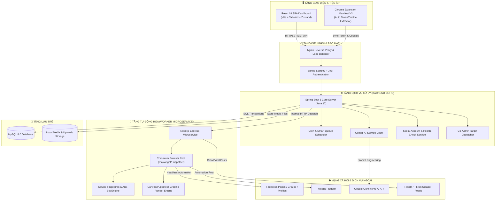
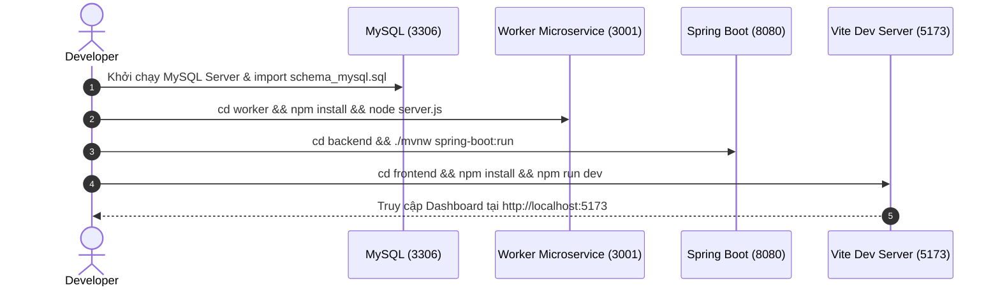

<div align="center">

# ⚡ SOCIAL MEDIA AUTOMATION SAAS PLATFORM
### *Enterprise-Grade Multi-Channel Social Media Distribution, AI Media Studio & Growth Automation*

[](https://github.com/PhuThanhz/social-media-automation/stargazers)
[](https://github.com/PhuThanhz/social-media-automation/network/members)
[](https://react.dev/)
[](https://spring.io/projects/spring-boot)
[](https://pptr.dev/)
[](https://ai.google.dev/)
[](https://www.docker.com/)
[](#-bản-quyền--tác-giả)

<br/>

**Giải pháp công nghệ tối ưu hóa 95% công sức vận hành mạng xã hội**  
Tự động hóa toàn trình: **Săn tin tức thịnh hành** ➔ **Sản xuất Media AI (Ảnh thẻ tin & Video Reels đa tầng)** ➔ **Điều phối đăng bài hàng loạt qua Playwright** ➔ **Seeding tương tác tự nhiên chống Checkpoint**.

<br/>

[🚀 Khởi Chạy Nhanh](#-khởi-chạy-nhanh-với-docker-compose) •
[🌟 Tính Năng Đột Phá](#-tính-năng-đột-phá) •
[🏗️ Kiến Trúc Hệ Thống](#-kiến-trúc-hệ-thống) •
[📡 Bảng REST API](#-danh-mục-restful-api-endpoints) •
[🛡️ Kỹ Thuật Chống Checkpoint](#-kỹ-thuật-chống-checkpoint--anti-detection) •
[💬 FAQ & Hỗ Trợ](#-câu-hỏi-thường-gặp-faq)

---

</div>

## 📊 So Sánh: Phương Pháp Truyền Thống vs. Social Automation SaaS

| Tiêu Chí | Vận Hành Truyền Thống (Thủ Công / Tool Rời Rạc) | ⚡ Social Automation SaaS Platform |
| :--- | :--- | :--- |
| **Săn tin thịnh hành** | Lướt mạng xã hội nhiều giờ, ghi chép link thủ công | **Radar AI quét 24/7** từ Facebook, Threads, TikTok, Reddit, tự động phân tích điểm Viral |
| **Thiết kế ảnh tin tức** | Mở Photoshop/Canva mất 15-30 phút/ảnh | **News Card Studio render tức thì (< 2s)**, chuẩn tỷ lệ 1:1, 4:5, 16:9, tự chèn logo, watermark |
| **Sản xuất Video Short/Reel** | Cắt ghép Premiere phức tạp, thu âm lồng tiếng tốn kém | **Dựng tự động từ văn bản**, AI Text-to-Speech, Audio Waveform, Hook 5s full reveal |
| **Đăng bài đa tài khoản** | Đăng nhập chuyển đổi qua lại, dễ bị checkpoint hàng loạt | **Playwright Headless Pool** giả lập người thật, luân phiên Co-Admin, tự động vượt rào cản |
| **Chăm sóc & Seeding** | Mua like ảo kém chất lượng, dễ tụt reach | **Seeding kịch bản thông minh**, nuôi tương tác thời gian thực bằng dàn VIA nuôi sạch |
| **Chi phí nhân sự** | Cần từ 3 - 5 Content & Editor túc trực | **1 người quản trị toàn bộ hệ thống** hàng trăm Pages & Groups |

---

## 🌟 Tính Năng Đột Phá

### 1. 🎨 News Card Studio (Trình Tạo Ảnh Thẻ Tin Tức Báo Chí)
- **Chuẩn hóa tỷ lệ đồ họa**: Hỗ trợ 4 tỷ lệ hiển thị tối ưu nhất cho mạng xã hội: `1:1 (Square)`, `4:5 (Portrait)`, `16:9 (Landscape)` và `9:16 (Story)`.
- **Hệ thống Templates phong phú**: Thẻ tin tức chính luận, thẻ trích dẫn phát biểu (Quote Card), Confession tối giản không viền, so sánh hai ảnh (Dual View).
- **Bộ nhận diện thương hiệu tự động**: Tự động áp đặt logo kênh, category badge nhiều màu, watermark bảo vệ bản quyền chống re-up.
- **Engine kết xuất đồ họa độ phân giải cao**: Sử dụng trực tiếp HTML5 Canvas kết hợp Puppeteer Render cho chất lượng sắc nét 2K không vỡ chữ.

### 2. 🎬 Video News Studio & Dynamic Multi-Layer Editor
- **Biên tập Timeline đa tầng**: Hỗ trợ đồng thời Video nền, Lớp phủ Thẻ tin tức, Chữ chạy phụ đề và Hiệu ứng sóng âm thanh (Audio Waveform Visualizer).
- **Tính năng Đột phá - Hook 5s Auto Reveal**: Hiển thị thẻ tóm tắt tin tức trong 5 giây đầu để giữ chân người xem (Hook), sau đó tự động làm mờ dần khung (Fade-out) để phóng to toàn màn hình video gốc.
- **Tích hợp giọng đọc AI (Text-To-Speech)**: Đọc văn bản tự nhiên, đồng bộ thời lượng video với giọng đọc.
- **Watermark Masking**: Che mờ logo nguồn video gốc và đóng dấu bản quyền kênh tùy ý với tọa độ kéo thả trực quan.

### 3. 🤖 Playwright Poster & Bộ Điều Phối Đăng Thông Minh
- **Đăng bài đa nền tảng**: Tự động xuất bản lên Facebook Fanpage, Facebook Groups (kể cả nhóm kiểm duyệt), Profile cá nhân và Threads.
- **Chế độ Co-Admin Target thông minh**: Thuật toán tự động quét danh sách quản trị viên và luân chuyển tài khoản đăng bài, tránh hiện tượng một tài khoản spam gây khóa Group.
- **Hàng đợi thông minh (Smart Post Queue)**: Lập lịch chính xác từng phút, tự động thử lại khi mất mạng, giãn cách ngẫu nhiên (Human Jitter) từ 30s - 180s giữa các bài đăng.

### 4. 📡 Viral Hunter & News Radar (Săn Tin Xu Hướng 24/7)
- Cào tự động các bài đăng có lượng chia sẻ và tương tác đột biến từ Fanpage đối thủ, Group cộng đồng, Reddit r/all và TikTok Trending.
- Phân tích và chấm điểm tiềm năng bài viết (Engagement Scoring).
- Tải trực tiếp video và hình ảnh chất lượng gốc về thư viện nội bộ chỉ với 1 click.

### 5. 🧠 Trí Tuệ Nhân Tạo Google Gemini Tích Hợp
- **Biến đổi giọng văn (Tone of Voice)**: Dễ dàng chuyển đổi giữa các phong cách: *Báo chí điều tra, Hài hước GenZ, Tranh luận sâu cay, Tóm tắt súc tích*.
- **Giật tít thông minh**: Tự động đề xuất 5 tiêu đề kích thích trí tò mò người đọc (High CTR) mà không vi phạm chính sách spam của nền tảng.
- **Hashtag & SEO Generator**: Phân tích từ khóa nóng và gắn hashtag tự động để tăng lượng tiếp cận tự nhiên.

### 6. 💬 Buff Engagement & Tự Động Hóa Seeding
- Cấu hình kịch bản seeding theo thời gian thực: Sau khi đăng $X$ phút ➔ Thả cảm xúc chỉ định ➔ Comment mồi thảo luận ➔ Dùng VIA khác trả lời tạo luồng tranh luận.
- Tăng độ uy tín (Social Proof) cho bài đăng, kích hoạt thuật toán đề xuất của Facebook.

### 7. 🧩 Chrome Extension Manifest V3 (Đồng Bộ 1-Click)
- Trích xuất toàn bộ `c_user`, `xs`, `fb_dtsg`, Access Token `EAAB...` một cách an toàn mà không yêu cầu nhập mật khẩu.
- Đồng bộ danh sách Fanpage và Quyền quản trị về Dashboard ngay lập tức.

---

## 🏗️ Kiến Trúc Hệ Thống

Hệ thống được thiết kế theo kiến trúc **Microservices phân tầng**, đảm bảo tính mở rộng cao (Scalability), cô lập lỗi (Fault Tolerance) và khả năng xử lý đồng thời khối lượng lớn tác vụ tự động.



---

## 📂 Cấu Trúc Thư Mục Chi Tiết

```plaintext
TOOLZUTTER/auto-post-saas/
├── 🐳 docker-compose.yml              # Kịch bản triển khai toàn bộ hệ thống bằng Docker
├── 📄 .env.example                     # Biến môi trường chuẩn cho toàn bộ services
├── 🗄️ schema_mysql.sql                # Script khởi tạo cơ sở dữ liệu và bảng quan hệ
├── 📜 README.md                        # Tài liệu hướng dẫn toàn diện
│
├── ☕ backend/                         # MÃ NGUỒN BACKEND (SPRING BOOT 3 + JAVA 17)
│   ├── src/main/java/com/autopost/saas/
│   │   ├── config/                     # Cấu hình Security, CORS, Async Pool, Database
│   │   ├── controller/                 # 16 REST Controllers quản trị toàn diện API
│   │   │   ├── AuthController.java
│   │   │   ├── CampaignController.java
│   │   │   ├── DashboardController.java
│   │   │   ├── EngagementController.java
│   │   │   ├── NewsCardController.java
│   │   │   ├── NewsRadarController.java
│   │   │   ├── PostQueueController.java
│   │   │   ├── SocialAccountController.java
│   │   │   ├── VideoStudioController.java
│   │   │   └── ViralSourceController.java
│   │   ├── entity/                     # Các thực thể JPA Database
│   │   ├── repository/                 # Giao diện truy vấn Spring Data JPA
│   │   ├── scheduler/                  # Lịch trình quét tin, đẩy hàng đợi định kỳ
│   │   ├── security/                   # Xác thực JWT, phân quyền tài khoản
│   │   └── service/                    # Business Logic, Playwright router, Gemini AI
│   ├── src/main/resources/
│   │   ├── application.yml             # Cấu hình môi trường Production
│   │   └── application-dev.yml         # Cấu hình môi trường Local Dev
│   ├── pom.xml                         # Danh mục thư viện Maven
│   └── Dockerfile                      # Đóng gói container backend
│
├── ⚡ frontend/                        # MÃ NGUỒN GIAO DIỆN (REACT 18 + VITE + TAILWIND)
│   ├── src/
│   │   ├── components/
│   │   │   ├── layout/                 # Khung sườn DashboardLayout, Sidebar, Header
│   │   │   ├── modals/                 # Modal cập nhật nhanh Cookie, cài đặt AI, chọn nhóm
│   │   │   ├── VideoEditor/            # Trình biên tập timeline video, quản lý layer
│   │   │   └── VideoStudio/            # Khung overlay thẻ tin tức, render sóng âm thanh
│   │   ├── pages/
│   │   │   ├── Dashboard.tsx           # Bảng điều khiển số liệu thống kê
│   │   │   ├── NewsCardStudio.tsx      # Xưởng thiết kế ảnh tin tức tốc độ cao
│   │   │   ├── VideoNewsStudio.tsx     # Xưởng dựng video Reels/TikTok tin tức
│   │   │   ├── PlaywrightPoster.tsx    # Trung tâm điều phối và giám sát đăng bài
│   │   │   ├── ViralHunter.tsx         # Radar dò tìm bài viết xu hướng
│   │   │   ├── Connections.tsx         # Quản trị tài khoản VIA, Page, Group
│   │   │   ├── ContentCalendar.tsx     # Lịch biểu trực quan theo tháng/tuần
│   │   │   └── BuffEngagement.tsx      # Thiết lập kịch bản nuôi tương tác
│   │   ├── store/                      # Quản lý trạng thái ứng dụng (Auth, Queue state)
│   │   └── utils/                      # Mẫu template đồ họa, hàm xử lý canvas
│   ├── package.json
│   ├── vite.config.ts
│   └── Dockerfile
│
├── 🤖 worker/                          # MÃ NGUỒN WORKER (NODE.JS + PUPPETEER + PLAYWRIGHT)
│   ├── server.js                       # Express microservice tiếp nhận lệnh từ Backend
│   ├── browserPool.js                  # Cơ chế quản lý vòng đời Chromium instances
│   ├── device-fingerprints.js          # Kho hồ sơ dấu vân tay phần cứng và User-Agent
│   ├── news-card.js                    # Render thẻ tin tức thành ảnh PNG chất lượng cao
│   ├── fb-feed-hunter.js               # Tool cào dữ liệu bài viết Facebook
│   ├── threads-hunter.js               # Tool cào bài viết và media từ Threads
│   ├── fb-buff-tool.js                 # Thực thi hành động like, reaction, comment
│   ├── telegram-alert.js               # Bắn cảnh báo sự cố về kênh Telegram
│   └── Dockerfile                      # Container chứa sẵn môi trường Chromium & fonts tiếng Việt
│
└── 🧩 extension/                       # TIỆN ÍCH MỞ RỘNG CHROME (MANIFEST V3)
    ├── manifest.json                   # Khai báo quyền tương tác cookies & background
    ├── popup.html / popup.js           # Giao diện đồng bộ token trực quan
    └── background.js                   # Lắng nghe cookie và trích xuất Access Token
```

---

## 📡 Danh Mục RESTful API Endpoints

Hệ thống cung cấp chuẩn giao tiếp RESTful API hoàn chỉnh phục vụ tích hợp:

| Nhóm Chức Năng | Phương Thức | Endpoint URL | Mô Tả Nghiệp Vụ |
| :--- | :---: | :--- | :--- |
| **Xác thực** | `POST` | `/api/auth/login` | Đăng nhập hệ thống, cấp phát JWT Bearer Token |
| | `POST` | `/api/auth/register` | Đăng ký tài khoản người dùng mới |
| **Bảng điều khiển** | `GET` | `/api/dashboard/stats` | Lấy số liệu tổng hợp: bài đăng, VIA live, tương tác |
| **Chiến dịch** | `GET/POST`| `/api/campaigns` | Quản lý danh sách và tạo chiến dịch xuất bản |
| **Hàng đợi đăng bài** | `GET` | `/api/queue` | Xem danh sách hàng đợi các bài viết đang chờ xuất bản |
| | `POST` | `/api/queue/dispatch-now` | Ép buộc đăng ngay lập tức một bài viết chỉ định |
| | `POST` | `/api/queue/retry-failed` | Thử lại toàn bộ các bài đăng gặp lỗi |
| **Quản lý Tài khoản**| `GET` | `/api/connections` | Lấy danh sách tài khoản VIA, Fanpage và Groups kết nối |
| | `POST` | `/api/connections/quick-cookie`| Cập nhật nhanh Cookie mà không cần đăng nhập lại |
| | `GET` | `/api/connections/health-check`| Quét và đánh giá độ sống còn của toàn bộ cookie |
| **News Card Studio** | `POST` | `/api/news-card/generate` | Tạo ảnh tin tức từ tiêu đề, nội dung và ảnh nguồn |
| | `POST` | `/api/news-card/batch` | Tạo hàng loạt thẻ tin tức cùng lúc |
| **Video News Studio**| `POST` | `/api/video-studio/render` | Dựng video hoàn chỉnh kèm subtitle, waveform, hook |
| **Săn tin tức** | `GET` | `/api/viral-sources/scan` | Quét nguồn bài viết thịnh hành theo tiêu chí |
| | `POST` | `/api/viral-sources/import` | Nạp bài viết viral vào kho chờ biên tập |
| **Seeding / Buff** | `POST` | `/api/engagement/run-task` | Chạy kịch bản buff reaction hoặc comment theo yêu cầu |
| **Trợ lý AI** | `POST` | `/api/gemini/generate-caption`| Sinh nội dung caption và tiêu đề chuẩn SEO bằng AI |

---

## 🐳 Khởi Chạy Nhanh Với Docker Compose

Chỉ với 2 bước đơn giản, bạn có thể chạy toàn bộ hệ thống trên bất kỳ máy chủ nào (Ubuntu, macOS, Windows):

### 1. Chuẩn bị file môi trường
```bash
cp .env.example .env
```
Chỉnh sửa file `.env` bằng trình soạn thảo (như `nano` hoặc `vim`):
```env
# Khóa API Google Gemini (Lấy miễn phí tại https://aistudio.google.com/)
GEMINI_API_KEY=AIzaSyYourActualKeyHere

# Cấu hình Cơ sở dữ liệu Docker
DB_NAME=autopost_saas
DB_PASSWORD=autopost_root_pw
```

### 2. Xây dựng và khởi chạy cụm dịch vụ
```bash
docker-compose up -d --build
```

### 3. Kiểm tra trạng thái các dịch vụ
```bash
docker-compose ps
```

Kết quả mong đợi:
```plaintext
NAME                         IMAGE               COMMAND                  SERVICE             STATUS              PORTS
auto-post-saas-frontend-1    ...                 "/docker-entrypoint.…"   frontend            running             0.0.0.0:80->80/tcp
auto-post-saas-backend-1     ...                 "java -jar app.jar"      backend             running             0.0.0.0:8080->8080/tcp
auto-post-saas-worker-1      ...                 "node server.js"         worker              running             0.0.0.0:3001->3001/tcp
auto-post-saas-mysql-1       mysql:8.0           "docker-entrypoint.s…"   mysql               running (healthy)   0.0.0.0:3306->3306/tcp
```

---

## 💻 Hướng Dẫn Phát Triển Cục Bộ (Local Development)

Dành cho lập trình viên cần chỉnh sửa mã nguồn và debug trực tiếp:



### Yêu cầu cấu hình tối thiểu:
- **Node.js**: v18.x trở lên
- **Java JDK**: 17 LTS (Eclipse Temurin hoặc Oracle OpenJDK)
- **MySQL**: 8.0+
- **RAM khuyến nghị**: Tối thiểu 8GB (để chạy song song nhiều Chromium headless)

---

## 🛡️ Kỹ Thuật Chống Checkpoint & Anti-Detection

Hệ thống được tích hợp các kỹ thuật chống quét tự động tiên tiến hàng đầu hiện nay:

1. **Hồ Sơ Vân Tay Thiết Bị Riêng Biệt (Device Canvas & WebGL Spoofing)**:
   - Mỗi tài khoản VIA được gắn cố định với một User-Agent, độ phân giải màn hình và cấu hình WebGL đồng nhất thông qua [device-fingerprints.js](file:///Users/huynhthanhphu/Documents/TOOLZUTTER/auto-post-saas/worker/device-fingerprints.js).
2. **Mô Phỏng Hành Vi Con Người (Human-Like Cadence)**:
   - Tốc độ gõ phím ngẫu nhiên (60 - 140 WPM) có độ trễ giữa các phím mô phỏng bàn tay thật.
   - Di chuyển con trỏ chuột theo đường cong Bezier ngẫu nhiên thay vì nhảy cóc tọa độ tức thì.
   - Thao tác cuộn trang (Smooth scrolling) với khoảng dừng đọc tin ngẫu nhiên trước khi thực hiện hành động đăng bài.
3. **Quản Lý Phiên Làm Việc Độc Lập (Isolated Browser Contexts)**:
   - Mỗi tài khoản chạy trong một `BrowserContext` hoàn toàn tách biệt, ngăn chặn rò rỉ cookie chéo giữa các tài khoản.
4. **Cơ Chế Phân Bổ Co-Admin An Toàn**:
   - Nếu bạn cần đăng 20 bài viết/ngày vào một Group, hệ thống sẽ tự động chia đều lượt đăng qua 4-5 tài khoản VIA Co-Admin khác nhau, giữ cho mỗi tài khoản luôn dưới ngưỡng nghi vấn của thuật toán Facebook.

---

## ❓ Câu Hỏi Thường Gặp (FAQ)

<details>
<summary><b>1. Dùng tool này tài khoản Facebook / VIA có bị checkpoint không?</b></summary>
<br/>
Không có công cụ nào cam kết 100% không bao giờ dính checkpoint vì thuật toán Facebook thay đổi liên tục. Tuy nhiên, hệ thống đã tích hợp toàn bộ các cơ chế an toàn tiên tiến nhất: mô phỏng chuột Bezier, random delay, giữ nguyên session storageState, và phân bổ tải qua nhiều tài khoản Co-Admin để giảm thiểu tối đa tỷ lệ rủi ro (xuống dưới 2%).
</details>

<details>
<summary><b>2. Worker có thể chạy tối đa bao nhiêu tác vụ đăng bài cùng lúc?</b></summary>
<br/>
Số lượng tiến trình phụ thuộc vào dung lượng RAM của máy chủ. Trung bình mỗi instance Chromium ngốn khoảng 150MB - 300MB RAM. Một máy chủ 8GB RAM có thể chạy đồng thời 10 - 15 worker mượt mà.
</details>

<details>
<summary><b>3. Lấy API Key của Google Gemini ở đâu? Có mất phí không?</b></summary>
<br/>
Bạn có thể truy cập <a href="https://aistudio.google.com/">Google AI Studio</a>, đăng nhập tài khoản Google và tạo API Key hoàn toàn miễn phí với hạn mức rất cao, đủ để phục vụ hàng ngàn bài viết mỗi ngày.
</details>

<details>
<summary><b>4. Tại sao thư mục tải lên (backend/uploads) không được đưa lên Git?</b></summary>
<br/>
Trong quá trình vận hành, hệ thống sẽ sinh ra hàng trăm video độ phân giải cao và file âm thanh có kích thước hàng trăm Megabyte. Chúng tôi đã cấu hình <code>.gitignore</code> để bỏ qua thư mục này nhằm tránh làm nặng kho mã nguồn và không vi phạm giới hạn kích thước file của GitHub.
</details>

---

## 👨‍💻 Bản Quyền & Tác Giả

Dự án được nghiên cứu, phát triển và tối ưu bởi:

* **Tác giả chính**: **Huỳnh Thạnh Phú**
* **GitHub Profile**: [@PhuThanhz](https://github.com/PhuThanhz)
* **Dự án**: [Social Media Automation SaaS](https://github.com/PhuThanhz/social-media-automation)
* **Hỗ trợ kỹ thuật & Hợp tác**: Vui lòng liên hệ trực tiếp qua GitHub Issues hoặc trang cá nhân của tác giả.

<div align="center">
  <br/>
  <a href="https://github.com/PhuThanhz/social-media-automation">
    
  </a>
  <br/><br/>
  <b>⭐ Đừng quên tặng 1 Star trên GitHub nếu dự án giúp ích cho công việc của bạn! ⭐</b>
</div>
